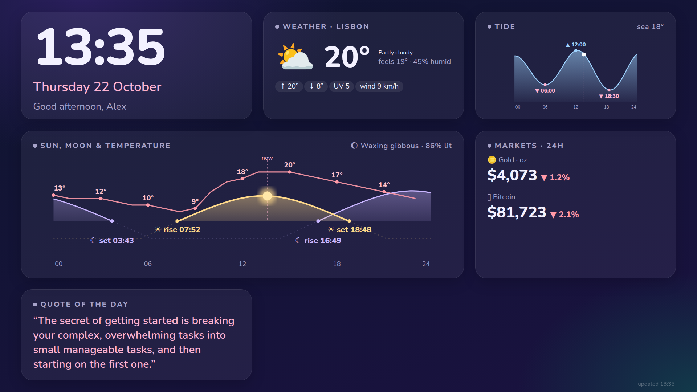

# Morning dashboard

A full-screen dark "good morning" page for a TV, tablet or wall display: clock, weather, today's
sun and moon paths with the hourly temperature, tide curve, gold and Bitcoin, quote of the day,
and optional reminders and a notes feed. Static HTML plus one JSON file built by a small Python
script. No framework, no accounts, no API keys.



- **Fails honestly.** A source that is down shows "unavailable", never an empty or zero value.
  A failed refresh keeps the last good reading and marks it "as of hh:mm".
- **Quiet on the network.** It only calls the APIs around your alarm time or while the page is on
  screen, so a TV that is off all day makes no requests.
- **No LLM, no tracking.** Every number comes straight from a public API.

## Quick start

```bash
git clone https://github.com/EliasAbouKhater/tv-dashboard && cd tv-dashboard
python3 -m venv .venv && .venv/bin/pip install -r requirements.txt
cp config.example.json config.json           # set your name, timezone, coordinates
.venv/bin/python build.py --force            # writes www/morning.json
.venv/bin/python serve.py --bind 0.0.0.0     # http://<this-machine>:8777/morning.html
```

Open the URL in any browser (on Android TV, TV Bro or a similar browser works). Then keep it
fresh with cron:

```cron
*/5 * * * * /path/to/tv-dashboard/.venv/bin/python /path/to/tv-dashboard/build.py >> /path/to/tv-dashboard/build.log 2>&1
```

`serve.py` should run as a service (a systemd unit, `docker`, or `tmux` all work). Bind it to a
private address (LAN or VPN); there is no authentication.

## Configuration (`config.json`)

| Key | Meaning |
|---|---|
| `name` | Greeting name. Empty gives "Good morning". |
| `timezone` | IANA zone, e.g. `Europe/Lisbon`. All clocks and "today" use it. |
| `location` | `label`, `latitude`, `longitude` for weather, sun and moon. |
| `sea` | `latitude`, `longitude` of open water near you, for the tide. A land point has no data. |
| `alarm` | `weekday` and `weekend` times (`"07:30"`), optional `weekend_days` (0 = Monday; default `[5, 6]`). `null` disables alarm-window builds. |
| `sections` | Booleans: `weather`, `sky`, `tide`, `prices`, `quote`, `reminders`, `log`. |
| `log` | `file` and `title` for the notes feed (see below). |
| `reminders_file` | JSON list of reminders (see below). |
| `radio_streams` | `[name, url]` pairs for alarm mode. |

Relative paths resolve against the config file's folder. The layout is tuned for the default
cards; switching sections off leaves a gap rather than reflowing the grid.

### When it builds

`build.py` builds when the page was seen in the last 10 minutes (every 15 min), and, if `alarm` is
set, from 30 min before to 75 min after the alarm (every 15 min, every 4 min in the last 12 minutes
so the data is fresh when you wake up). Otherwise a cron tick does nothing. `--force` always builds.

### Notes feed (`log`)

Shows the last 3 entries of a markdown file with lines in this shape, using the first sentence:

```
- 2026-10-19 — [project] Switched to X because Y. More detail that is not shown.
```

### Reminders

A JSON list; the dashboard shows today's entries and strikes through the `fired` ones:

```json
[{"at": "2026-10-19T18:30:00", "msg": "Take the bread out", "status": "pending"}]
```

### Alarm mode

Open `morning.html?alarm=1` to also play the first working stream from `radio_streams` (falls
through the list on errors, stops after `&stop=<minutes>`, default 45). Browsers block autoplay,
so something has to tap or click the page once; on Android TV an `adb shell input tap` does it.
Triggering the page at the right time (waking the TV, launching the browser) is up to you and is
not part of this repo.

## Data sources

| Data | Source |
|---|---|
| Weather, tide, sea temperature | [Open-Meteo](https://open-meteo.com) (free for non-commercial use, CC BY 4.0) |
| Sun and moon | computed locally with [astral](https://github.com/sffjunkie/astral) |
| Bitcoin, gold 24h change | [CoinGecko](https://www.coingecko.com) public API |
| Gold spot price | [gold-api.com](https://gold-api.com) |
| Quote | [ZenQuotes](https://zenquotes.io) (attribution required, rate-limited: fetched once a day) |

Check each provider's terms before running this commercially or at scale. Tide values are a model,
not a navigation product.

## Tests

```bash
.venv/bin/python tests/test_gate.py
```

Covers the build gate, stale fallback, config checks and the notes and reminders parsing; no network.

## License

MIT, see [LICENSE](LICENSE).
